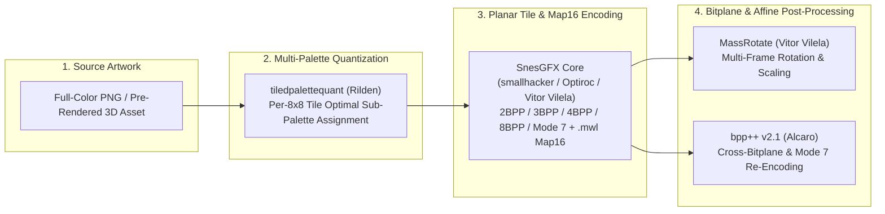

# PiXeL Digitizer (`Pixel-Digitizer`)

**PiXeL Digitizer** is an integrated Super Nintendo (SNES) graphics digitization, multi-palette tile quantization, planar bitplane conversion, and affine sprite-sheet generation suite maintained by **Vivien Sweetbrier**.

It unifies the historical lineage of SNES graphics converters (`snesgfx` $\to$ `SnesGFX` $\to$ `tiledpalettequant` $\to$ `MassRotate` & `bpp++`) into a single workflow capable of converting high-color artwork, 3D pre-rendered models, and complex multi-palette backgrounds into hardware-ready SNES `2BPP`, `3BPP`, `4BPP`, `8BPP`, and `Mode 7` assets and Lunar Magic `.mwl` / `.pal` / `ExGFX` binaries.

---

## Architecture & Pipeline Flowchart

---

## Provenance, Lineage & Credits

This repository strictly honors the engineering lineage of every tool and author whose work made modern SNES graphics conversion possible:

### 1. **smallhacker** & **Optiroc** — *The Pioneers of `snesgfx` & SNES Hardware Research*
- **smallhacker** laid the foundational groundwork for SNES graphics conversion utilities (`snesgfx`) and SMW reverse-engineering—most famously as the very first person to discover Super Mario World's legendary **Level `1F0` Glitch**, alongside countlessly creative hardware and engine discoveries that defined the early golden era of SMW hacking.
- **Optiroc** (`SuperFamiconv` / early `snesgfx` bitplane & optimal palette packing algorithms) established the gold-standard mathematical techniques for packing SNES planar tiles, deduplicating flipped $8\times 8$ tiles, and optimizing sub-palette allocation across scanlines and tilemaps.

### 2. **Vitor Vilela** — *`SnesGFX 2.62` (C# GUI/CLI) & `MassRotate`*
- Authored the C# `SnesGFX` architecture (`SnesGFX.csproj`, planar/linear/packed/Mode 7 `IBitformat` codecs, and Lunar Magic `.mwl` tilemap generation) as well as **`MassRotate`**, which generates multi-frame rotated and scaled `2BPP`/`3BPP`/`4BPP`/`8BPP`/`Mode 7` sprite sheets.

### 3. **Rilden** — *`tiledpalettequant`*
- Authored **`tiledpalettequant`** (`quantizer-core.js`, `worker.js`), the k-means / perceptual color quantizer that solves multi-palette $8\times 8$ tile quantization so full-color images can be rendered using multiple 4BPP/2BPP SNES sub-palettes with minimal perceptual error.

### 4. **Alcaro** — *`bpp++` (v2.1)*
- Authored **`bpp++`** (`bpp++.cpp`), the ultra-fast C++ bitplane transcoder supporting arbitrary conversions and palette-offset shifts across `2BPP GB`, `3BPP SNES`, `4BPP SNES`, `8BPP SNES`, and `Mode 7` (`8BPP linear`).

### 5. **Vivien Sweetbrier** — *`PiXeL Digitizer v3.0` Integration & CLI Pipeline*
- Integrated `SnesGFX` directly with a headless CLI bridge to `tiledpalettequant` (`palettequant-cli.js`), unified the multi-palette quantization $\to$ planar tilemap/ExGFX $\to$ `.mwl` export pipeline, and bundled `MassRotate` and `bpp++` into a cohesive late-SNES ("Super Nintendo 1998") pre-rendered asset toolchain.
